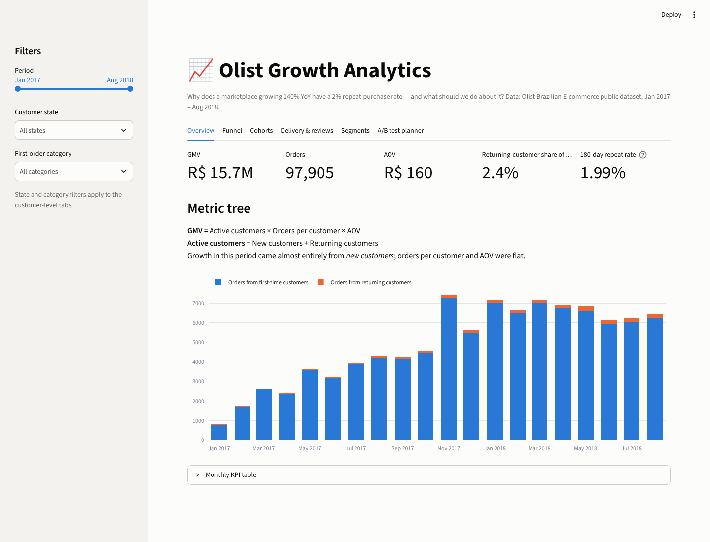
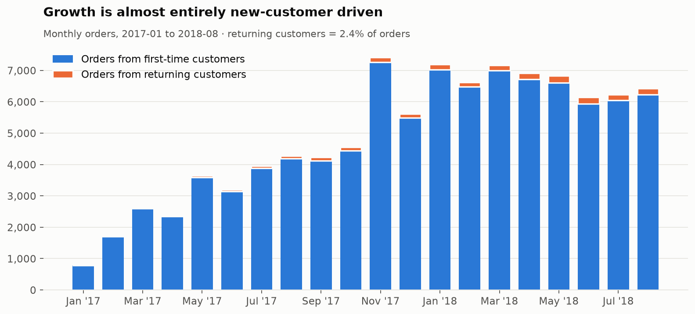
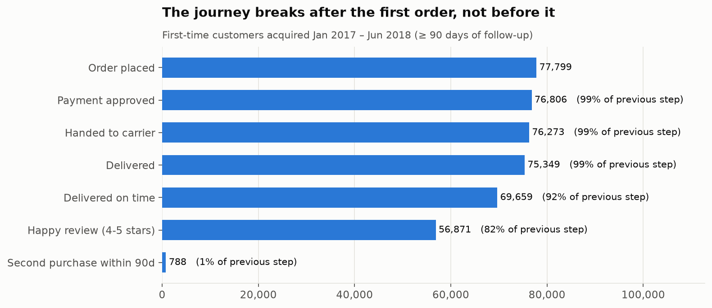
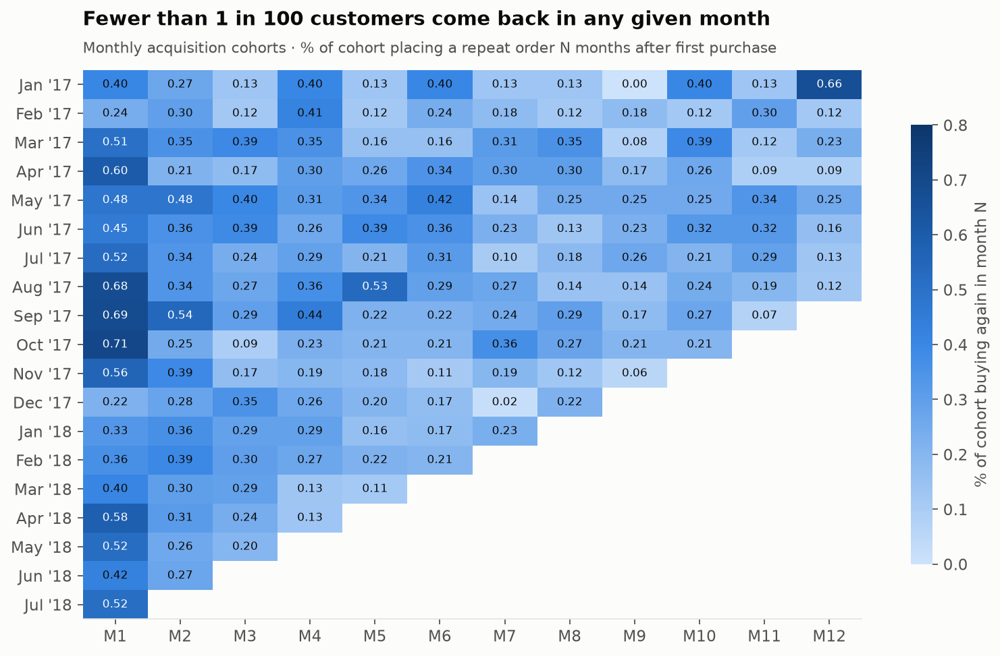
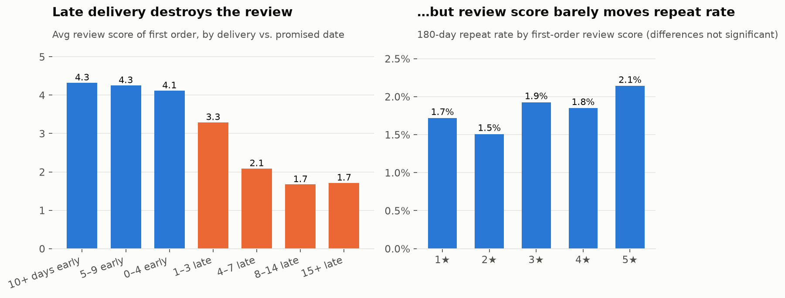
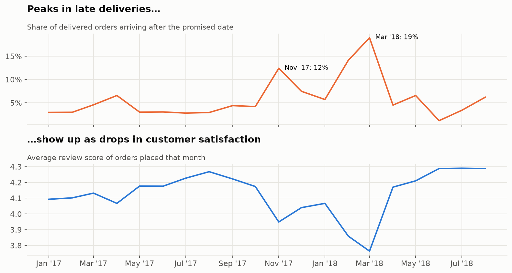
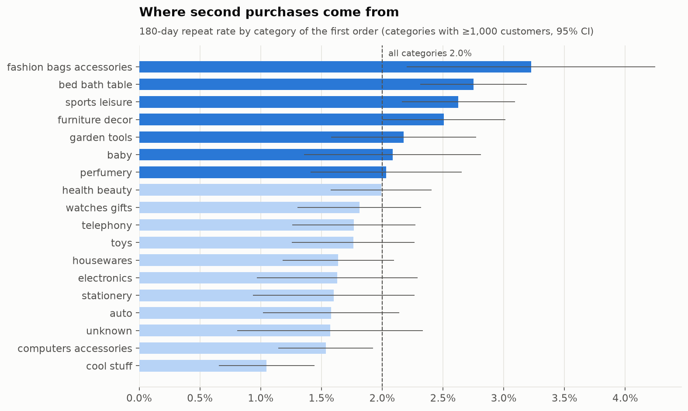
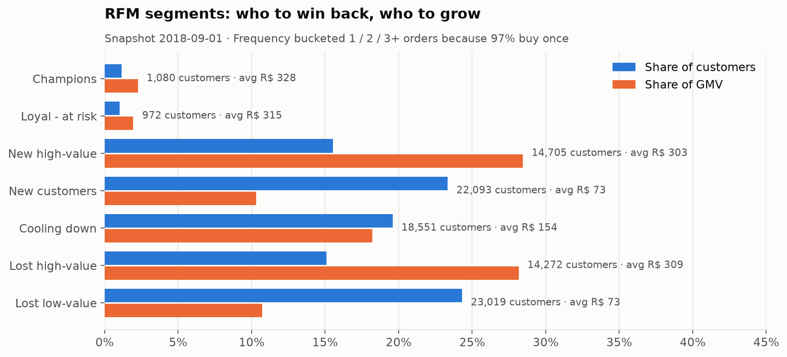

# 📈 Olist Growth Analytics

**Olist grew GMV +140% year over year, yet 98% of customers never come back. What drives a second purchase, and where should the next growth dollar go?**

An end-to-end growth analytics case study on ~100k real orders from the Brazilian marketplace Olist. It covers a SQL warehouse with data tests, a metric tree, funnel, cohort and RFM analysis, a driver model, A/B test design, and an interactive Streamlit dashboard. It ends with three recommendations, each with a sized impact.

`SQL (DuckDB)` · `Python` · `pandas` · `statsmodels` · `Streamlit` · `Plotly` · `Product analytics` · `Experimentation`



---

## TL;DR: key findings

| # | Finding | Evidence |
|---|---|---|
| 1 | **Growth is ~98% acquisition.** GMV grew +140% (Jan–Aug 2018 vs 2017) because new customers grew +136%. Orders per customer (−0.7%) and AOV (+1.3%) were flat. | Metric tree |
| 2 | **Only 2.0% of customers buy again within 180 days** (1.3% within 90 days). The median gap to the second order is 74 days. | Cohorts |
| 3 | **The funnel breaks *after* a good experience, not before.** 73% of first-time buyers get an on-time delivery and leave a 4–5★ review, but only 1 in 100 buys again. | Funnel |
| 4 | **Late delivery hurts reviews badly.** Avg review drops from 4.3★ to 2.1★ at 4–7 days late, and 59% of those reviews are 1★. Late rates spiked to 12% (Nov '17) and 19% (Mar '18). | Delivery analysis |
| 5 | **…but its effect on repeat purchase is *not* statistically significant** (odds ratio 0.80, 95% CI 0.61–1.03). The first-order **category** is a much stronger signal: bed/bath/table buyers return about 2.7× more often than "cool stuff" buyers. | Logistic regression |
| 6 | **A repeat-purchase A/B test is slow.** At a 1.3% baseline, detecting a +20% lift needs ~32k customers per arm (≈10 months of traffic). In a simulated test, the coupon was **significant but unprofitable**. | Experiment design |

## Recommendations

1. **Fix delivery-promise reliability at peaks (highest priority).** The ETA is padded by ~12 days on average (median delivery arrives 12 days *early*), yet it is still breached at peaks and in BA/RJ (12% late). Use a dynamic ETA buffer by season and region. *Why:* about 98% of growth comes from new customers, and public reviews are their main trust signal. The late-delivery peaks coincided with the platform's average review falling from ~4.2 to 3.8.
   *Metric:* late-delivery rate < 5% every month; % of 1★ reviews. *Next test:* measure checkout conversion vs. ETA length (not observable in this dataset).
2. **Launch a category-targeted second-purchase lifecycle flow instead of blanket coupons.** Focus on high-repeat categories (bed/bath, furniture/decor, sports, bags) and time the nudge for days 30–75, around the median repurchase gap. Always keep a holdout group.
   *Sizing:* lifting 180-day repeat by +1 pp ≈ **+775 repeat customers ≈ R$130k GMV per year** (see assumptions below). This is meaningful but modest, so treat it as a margin play, not the main growth engine.
3. **Make the measurement fit the business.** Add *90-day repeat rate* and *on-time delivery rate* as input metrics under the North Star. Design experiments for MDE ≥ 30% (≈ 4.7 months) or use leading indicators such as click-through or session return. Always run a unit-economics check alongside the p-value.

➡️ One-page version: [`reports/executive_summary.md`](reports/executive_summary.md)

---

## 1. Problem & metric tree

**Business question:** *Is Olist's growth healthy, and what is the highest-leverage lever for the next 12 months?*

```
North Star: Monthly GMV from delivered orders
│
├── Active customers
│   ├── New customers ............... +136% YoY   ← all of the growth
│   └── Returning customers ......... +392% YoY, but only ~2.4% of orders
│       └── 90-day repeat rate (1.3%)  ← input metric
│           ├── First-order experience: on-time delivery (93%), review ≥ 4★ (78%)
│           └── Category mix / lifecycle messaging
├── Orders per active customer ...... −0.7% YoY (flat)
└── Average order value ............. +1.3% YoY (flat, ~R$160)
```



## 2. Funnel: where do customers drop?



Operations lose only ~3% of customers before delivery and ~10% by the on-time step. The real cliff is the last step: **98.6% of happy customers do not come back within 90 days.**

## 3. Cohort retention



Every cohort shows the same flat curve: ~0.5% buy again in month 1, then ~0.2–0.3% per month. This is a structurally *one-time-purchase* marketplace. There is no clear improvement trend across cohorts, which suggests retention was never a lever the company actively pulled.

## 4. Delivery experience → review → repeat




Logistic regression on 55,737 customers with 180 days of follow-up, controlling for category, state, payment type and order value:

| Term | Odds ratio | 95% CI | p |
|---|---|---|---|
| First order delivered late | 0.80 | 0.61 – 1.03 | 0.08 |
| …controlling for review (late) | 0.85 | 0.65 – 1.12 | 0.25 |
| Happy review (4–5★) | 1.13 | 0.97 – 1.32 | 0.13 |

**Interpretation:** the direction is negative, but with a 2% base rate the effect cannot be distinguished from zero. I do **not** claim that late delivery kills retention. The defensible claim is that late delivery destroys *reviews*, which matters for *acquisition* (hypothesis to test).

## 5. Who comes back: category & segments




RFM is adapted to the data: Frequency is bucketed into 1 / 2 / 3+ orders because quintiles collapse when 97% of customers have one order. Two segments, *New high-value* and *Lost high-value*, hold 30% of customers and 57% of GMV. These are the audiences for recommendation #2.

## 6. Experiment design: second-purchase coupon

**Hypothesis:** a R$10 coupon sent 7 days after delivery raises the 90-day repeat rate.

| Relative MDE | Customers / arm | Months to enrol |
|---|---|---|
| 10% | 124,262 | 38.5 |
| 20% | 32,475 | 10.1 |
| **30% (chosen)** | **15,047** | **4.7** |
| 50% | 5,846 | 1.8 |

*α = 0.05, power = 0.8, baseline 1.31%, ~6,458 new customers per month.*

**Simulated readout** (synthetic data, seed 42, used *only* to demonstrate the workflow): control 1.16% vs treatment 1.71%, +48% relative lift, 95% CI of the difference +0.28 to +0.82 pp, p < 0.001. **Statistically significant, but per 1,000 customers it generates R$123 of incremental margin vs R$171 of coupon cost.** Coupons are also paid to customers who would have bought anyway. The decision would be **don't ship as is**: target high-repeat segments or lower the incentive.

The dashboard's **A/B test planner** tab lets you redo this with any inputs.

## 7. Opportunity sizing & assumptions

| Scenario (180-day repeat) | Extra repeat customers / yr | Extra GMV / yr |
|---|---|---|
| 2.0% → 2.5% | 388 | R$ 65k |
| 2.0% → 3.0% | 775 | R$ 130k |
| 2.0% → 4.0% (×2) | 1,543 | R$ 258k |

Assumptions: 77,500 new customers per year (2018 run-rate); R$167 GMV per repeat customer (observed); 15% take rate for margin calculations (assumption, not in the data). Even doubling retention adds ~2% to GMV. That is why recommendation #1 (protect acquisition) ranks above #2.

---

## Methodology notes (the details that matter)

- **Person vs order IDs.** Olist issues a new `customer_id` for every order, so all customer metrics use `customer_unique_id`.
- **Same-day orders are not repeats.** About 30% of apparent "repeat customers" only placed extra orders on the same day as their first one, which usually means one basket split across checkouts. Counting them would inflate the repeat rate by ~40%.
- **Right-censoring.** 90/180-day repeat rates only include customers with at least 90/180 days of follow-up. Unobservable cohort cells are blanked, not shown as 0.
- **Analysis window.** Jan 2017 – Aug 2018. 2016 and Sep–Oct 2018 are sparse or incomplete. Order sequence is computed over the full history, so 2016 buyers aren't miscounted as new.
- **Data tests.** Uniqueness, not-null, one-first-order-per-customer, retention bounds and funnel monotonicity are checked on every build (`src/pipeline.py`).
- **Limitations.** No traffic/session data, so the funnel starts at the order. No marketing spend, so no CAC/LTV ratio. Observational data, so the regression shows association, not causation.

## Project structure

```
├── app/streamlit_app.py      interactive dashboard (6 tabs)
├── data/
│   ├── raw/                  source CSVs (git-ignored, `make data`)
│   └── marts/                small parquet exports used by the app (committed)
├── sql/
│   ├── staging/              cleaning & typing (stg_*)
│   └── marts/                fct_orders, dim_customers, KPI / cohort / funnel / RFM marts
├── src/
│   ├── pipeline.py           builds the DuckDB warehouse + runs data tests
│   └── analysis.py           statistics, models, figures, results.json
├── reports/
│   ├── executive_summary.md
│   ├── results.json          every number quoted in this README
│   └── figures/
└── docs/                     dashboard screenshots
```

## Run it

```bash
git clone https://github.com/<your-username>/olist-growth-analytics.git
cd olist-growth-analytics
pip install -r requirements.txt
make all        # download data → build warehouse → run analysis (~10 s)
make app        # open the dashboard at localhost:8501
```

No `make`? Run `python scripts/download_data.py && python src/pipeline.py && python src/analysis.py`, then `streamlit run app/streamlit_app.py`.

## Data

[Olist Brazilian E-commerce Public Dataset](https://www.kaggle.com/datasets/olistbr/brazilian-ecommerce) (CC BY-NC-SA 4.0): ~100k orders placed between 2016 and 2018.
